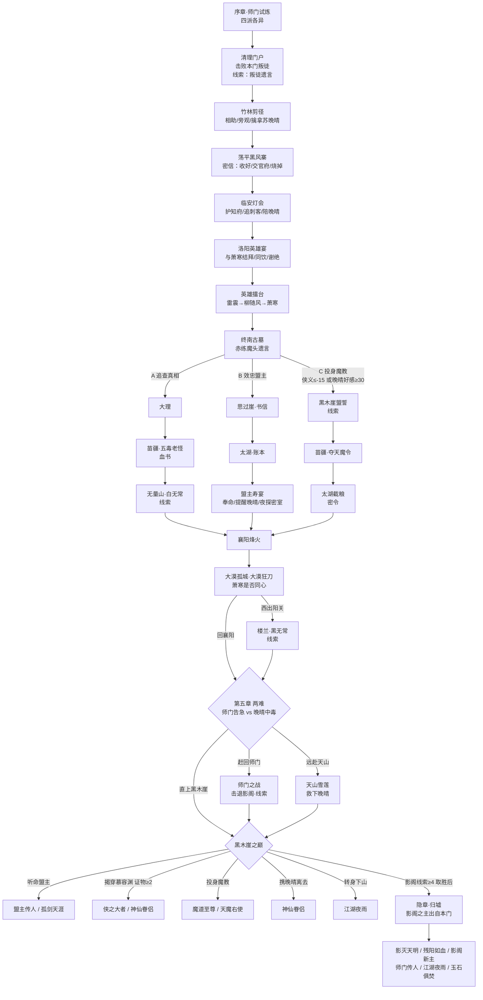

# 江湖行 v3 剧情流程与结局攻略

本文件是游戏内「江湖志 → 剧情指引」的完整版，方便对照节点存档逐一解锁全部 **12 种结局**。

## 主线流程

## 四派差异

| 门派 | 师门 | 序章叛徒 | 第五章来犯者 | 出师试炼 | 镇派神兵 | 影阁之主（最终首领） |
| --- | --- | --- | --- | --- | --- | --- |
| 少林 | 少室山 | 盗经叛僧·慧空 | 影阁·铁罗汉 | 十八铜人 | 金刚指环 | 达摩院首座·慧明 |
| 武当 | 武当山 | 叛徒·玄冥子 | 影阁·玄冥二老 | 真武七星阵 | 真武剑 | 掌门大弟子·清虚 |
| 峨眉 | 峨眉金顶 | 血手人屠 | 影阁·血观音 | 金顶守山尼 | 青霜剑 | 戒律院首座·静玄 |
| 丐帮 | 君山总舵 | 彭长老 | 影阁·摄魂使 | 打狗阵 | 镇帮神棒 | 执法长老·钱不易 |

## 十二种结局

| # | 结局 | 达成条件 |
| --- | --- | --- |
| 1 | 侠之大者 | 黑木崖揭穿慕容渊（证物 ≥ 2）并取胜；影阁线索不足 4 条；不与苏晚晴归隐 |
| 2 | 神仙眷侣 | 救下苏晚晴且好感 ≥ 70 时带她离开；或揭穿后携她归隐（好感 ≥ 60）；或诛灭影阁后携她归隐 |
| 3 | 魔道至尊 | 投身魔教（侠义 ≤ -20 或走过 C 线）诛杀慕容渊后，与厉天行决战并取而代之 |
| 4 | 盟主传人 | 听命盟主诛杀天魔教主，苏晚晴好感 < 40；影阁线索不足 4 条 |
| 5 | 孤剑天涯 | 听命盟主诛杀天魔教主，苏晚晴好感 ≥ 40；影阁线索不足 4 条 |
| 6 | 天魔右使 | 投身魔教诛杀慕容渊后，拜见教主 |
| 7 | 影灭天明 | 隐藏终章诛灭影阁主后执掌武林；萧寒同心、苏晚晴获救在世、师门得保三者俱全 |
| 8 | 残阳如血 | 隐藏终章诛灭影阁主后执掌武林，但上述三者未能俱全 |
| 9 | 影阁新主 | 归墟中接受影阁主的邀请（侠义 ≤ 0 或曾入魔教） |
| 10 | 师门传人 | 诛灭影阁主后回归师门（师门得保且侠义 ≥ 30） |
| 11 | 江湖夜雨 | 黑木崖上转身下山；或诛灭影阁主后孑然一身 |
| 12 | 玉石俱焚 | 归墟中以身为饵，与影阁同归于尽 |

## 影阁线索（≥ 4 开启隐藏终章）

叛徒遗言（序章）、灯会刺客的影字令（灯会追击刺客）、白无常遗言（A 线无量山）、密室中的面具人（B 线夜探密室）、厉天行的回忆（C 线盟誓）、黑无常遗言（楼兰）、师门之战（第五章）、影阁密信（支线）。

## 证物（≥ 2 可揭穿慕容渊）

黑风寨密信、思过崖书信、太湖账本、老药王血书、大漠狂刀遗言、太湖密令、寿宴密谈、老药王亲证。

## 支线

师门秘传（镇派神兵）、萧家庄旧址（寒梅剑法 / 萧寒更强）、晚晴的心事（同心紫玉簪）、镖银失踪、铸剑（陨铁神兵四选一）、影阁密信（影阁线索）。

## 存档与节点

- 20 个存档位，行动后自动保存。
- 每个关键抉择出现前自动存一个**节点存档**（每个存档位最多 40 个），可在「江湖志 / 系统 → 节点回溯」或存档列表的「节点」按钮中读取：
  - **从此重走**：覆盖当前存档位，回到该抉择前；
  - **复制后重走**：复制到第一个空存档位，保留原进度。
